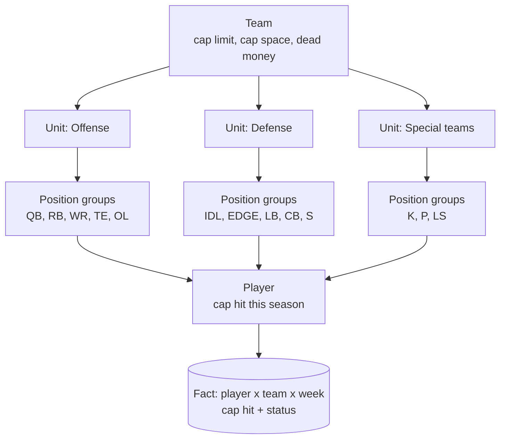
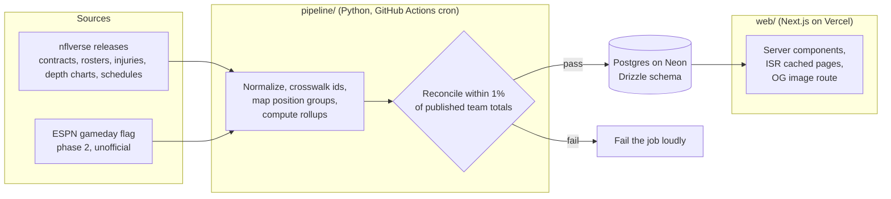
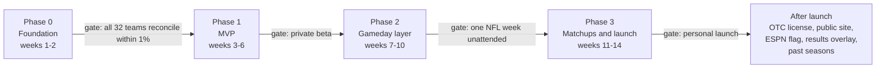

# NFL Salary Cap Tracker — Project Plan

2026-11-09 · Jake Cates

> Committed copy of the project plan. The live, editable version is the Claude Doc [NFL Salary Cap Tracker — Project Plan](https://claude.ai/artifact/3xNq9fQ7AMCTzTpvuy47Ex); when the two differ, update this file from the doc. Phase 0 findings from the day-one data check live in [docs/phase0-findings.md](docs/phase0-findings.md).

## Vision and scope

The site answers one question first: where is each NFL team's salary cap actually going, and how much of that money is on the field this week? Everything else is a lens on that same number.

Three core questions the product answers, in priority order:

1. **Where is the money?** For any team, the cap broken down by side of the ball (offense, defense, special teams), then by position group (QB, OL, WR, DL, secondary, etc.), down to the player.
2. **How much of it is playing this week?** Each game week, every dollar is tagged active or inactive based on injury reports and gameday inactives, so a team paying a star who is out shows a large inactive share. Dead money is shown separately since it never plays.
3. **Who wins the matchup on paper?** For a given game, each position group is compared to the opposing unit it faces (OL vs. DL, WR vs. secondary, pass rush vs. pass protection). Lopsided investment is highlighted as the expected edge.

Scope for the first version: all 32 teams, the current league year, regular season and playoffs. Out of scope for now: historical seasons, contract negotiation tools, fantasy integrations, and user accounts.

The audience is NFL fans who like numbers: cap nerds, bettors looking for an edge, and fans checking their own team before kickoff. It starts as a personal tool for Jake, built so that going public later means a data license and a domain, not a rewrite. The site is read-only with no login.

## Data sources

Build on the free nflverse datasets first, and get a written data license from OverTheCap before the site goes public. Both major contract sites forbid scraping and commercial use in their terms, so the licensing path matters more than the technical one.

### Contracts and cap hits

| Source | What it gives | Access | Terms | Fit |
| --- | --- | --- | --- | --- |
| [OverTheCap](https://overthecap.com/about) (OTC) | Per-player cap number, base salary, prorated bonus, dead money, team cap space, by year | Website only, no public API | [Terms](https://overthecap.com/terms-and-conditions) prohibit systematic retrieval, derivative works and any commercial use without written consent; they direct licensing requests to support@overthecap.com | Best data in the space. The right licensing partner for launch |
| [Spotrac](https://www.spotrac.com/about) | Same coverage as OTC plus cash and transaction history | Website only, Premium tier is for readers | [Terms](https://www.spotrac.com/service) prohibit scrapers, republishing on the internet and any revenue-generating use; no data licensing program is described | Fallback for manual cross-checks only |
| [nflverse contracts](https://rdrr.io/cran/nflreadr/man/load_contracts.html) | `historical_contracts` file sourced from OTC: player, team, position, years, total value, APY, guaranteed, APY as % of cap, OTC id and player URL ([dictionary](https://cloud.r-project.org/web/packages/nflreadr/vignettes/dictionary_contracts.html)) | Free download as CSV or parquet from [GitHub releases](https://github.com/nflverse/nflverse-data/releases), no key | Repository is CC BY 4.0, but the underlying numbers are OTC's | Use for the prototype. Verify on day one whether the release carries a nested per-year table with cap numbers; if not, cap hit must be derived from APY or licensed |
| [SportsDataIO](https://sportsdata.io/help/data-rights-and-licensing-questions) | Licensed NFL feeds, with a contracts feed to confirm | Commercial license, quoted per client; free personal tier covers last season only | Public display is a licensed use; attribution required; minimum fees apply | Paid option if OTC declines |

### Weekly injury and active status

| Source | What it gives | Update cadence | Terms | Fit |
| --- | --- | --- | --- | --- |
| [nflverse injuries](https://rdrr.io/cran/nflreadr/man/load_injuries.html) | Official injury report per player: report status (Out, Doubtful, Questionable), practice status, injury body part ([dictionary](https://cloud.r-project.org/web/packages/nflreadr/vignettes/dictionary_injuries.html)) | Daily at 7 AM UTC in season ([schedule](https://nflreadr.nflverse.com/articles/nflverse_data_schedule.html)) | CC BY 4.0 | Primary source for Wednesday to Friday reports |
| [nflverse weekly rosters](https://rdrr.io/cran/nflreadr/man/load_rosters_weekly.html) | Roster status per player per week: ACT, INA, RES (injured reserve), PUP, SUS and more ([codes](https://archive.linux.duke.edu/cran/web/packages/nflreadr/vignettes/dictionary_roster_status.html)) | Daily at 7 AM UTC | CC BY 4.0 | Primary source for long-term inactive money (IR, PUP, suspension) |
| nflverse depth charts | Starter vs. backup per position | Daily at 7 AM UTC | CC BY 4.0 | Weight starters in matchup scores |
| [ESPN unofficial API](https://gist.github.com/nntrn/ee26cb2a0716de0947a0a4e9a157bc1c) | Team injuries endpoint; per-game competitor rosters with a real-time `active` flag | Near real time | Undocumented and unsupported; can change or be cut off without notice | Only practical free signal for the 90-minute gameday inactives list |
| [Sleeper player map](https://sportsapis.dev/nfl-api) | One JSON file of all players with an `injury_status` field | Daily (file is about 15 MB; one pull per day) | Free, no key | Cheap cross-check |
| [Sportradar NFL](https://developer.sportradar.com/football/reference/nfl-weekly-injuries) | Weekly injuries with practice and game status, estimated return date | 4-hour cache; hourly pulls recommended | Free trial key; production is a paid contract | Upgrade path if the site needs supported gameday data |

### Licensing recommendation

- **P****ersonal use (now)****:** nflverse files only. No scraping of OTC or Spotrac, which keeps the project clean if a license talk starts.
- **Before public launch:** email OTC for a data license and offer prominent attribution and links back to player pages. OTC's founder has said publicly there is [room for several sites](https://overthecap.com/site-news-explaining-my-issues-with-another-website-and-hopefully-closing-the-matter) doing similar work; his objection is wholesale copying without credit.
- **If OTC declines:** narrow scope to the aggregates the site needs (position group totals) so the raw contract table is never republished. Paid feeds such as SportsDataIO are off the table by Jake's choice, so this is the only fallback.
- **Gameday inactives:** official lists drop 90 minutes before kickoff and no free, supported API carries them. Phase 1 approximates with IR, PUP, suspension and Friday's Out or Doubtful designations. Phase 2 adds the ESPN gameday roster flag with a visible "unofficial" label. Sportradar is listed only for completeness; the site stays on free sources.

## Data model

The model is a four-level rollup with one fact table underneath it: a player's cap hit for one team in one week, tagged with that week's status. Every view on the site is a sum or a comparison over that table.

*Diagram: data model: team, unit, position group, player.*

Position groups are the unit of analysis. Players are mapped into a fixed set of 13 groups, and each group belongs to one of three units. Position labels from the roster feed (for example DE vs. OLB) are normalized into IDL or EDGE by a small lookup table that is edited by hand when the feed disagrees with reality.

| Entity | Key fields | Source | Notes |
| --- | --- | --- | --- |
| Team | id, abbreviation, conference, division, primary and secondary colors | nflverse teams | Colors drive the UI |
| Season cap | team, season, cap limit, adjusted cap, cap space, dead money total | OTC via license, nflverse for prototype | One row per team per season |
| Player | id (nflverse gsis_id), OTC id, ESPN id, name, position, group, unit | nflverse players, contracts | Cross-walk table maps ids across feeds |
| Contract year | player, team, season, base salary, prorated bonus, roster and workout bonus, cap hit, cap % of team cap, dead money if cut | OTC | The money facts; refreshed daily in season |
| Player week status | player, team, season, week, roster status (ACT, INA, RES, PUP, SUS), report status (Out, Doubtful, Questionable), practice status, gameday flag (active, inactive, unknown), as-of timestamp | nflverse injuries, weekly rosters, ESPN gameday flag | One row per player per week, kept as history so past weeks are reproducible |
| Game | id, season, week, home team, away team, kickoff time, status | nflverse schedules, ESPN scoreboard | Drives the gameday and matchup pages |
| Matchup pair | offense group set, defense group set, label | Hand-defined | OL vs. IDL + EDGE, WR + TE vs. CB + S, RB vs. LB, QB vs. whole pass defense |

Accounting rules, decided up front so the numbers stay consistent:

- **Active money** is the cap hit of players on the active roster who are not Out, Doubtful (before kickoff) or inactive (after the 90-minute list).
- **Inactive money** is the cap hit of players on IR, PUP, NFI or suspension plus those ruled Out or inactive. Each inactive dollar carries a reason so the UI can say why.
- **Dead money** is cap space charged for players no longer on the team. It is shown as its own slice and never counted as active or inactive.
- **Questionable** players count as active until the inactive list is known, with a hatched "uncertain" treatment in the charts.
- **Practice squad** salaries count against the cap but are excluded from position group totals by default, with a toggle to include them.
- **Snapshots** are stored per week and never overwritten, so the Week 6 page in December still shows what was true in Week 6.

## Core views

Four pages carry the product. Each one answers a single question and leads with one big visual, with the table of players underneath for anyone who wants the detail.

### 1. Team cap breakdown

**Question:** where is this team's money going? **Hero visual:** a treemap of the full cap. The outer tiles are offense, defense, special teams and dead money. Inside each sit the position groups, sized by cap hit, and inside those the players. Clicking a tile zooms one level. A second strip below shows the same groups as a horizontal bar chart against the league median for that group, so a reader sees "this team spends 2x the league on OL" without doing math.

- Header: team name and colors, total cap, cap space, dead money, league rank in each.
- Toggle between dollars and percent of cap, and between this season and next season's committed money.
- Player table: name, position, group, cap hit, percent of cap, contract years left, this week's status.

### 2. Gameday active vs. inactive money

**Question:** how much of the payroll is actually playing this week? **Hero visual:** one wide stacked bar per team, active in the team's primary color, inactive in a muted hatched version of it, dead money in neutral gray. A ticker-style list of the biggest inactive cap hits sits beside it with the reason (IR, Out, suspension, inactive list).

- League view: all 32 teams sorted by inactive dollars, so the week's most injured expensive rosters float to the top.
- Team view: the same split by unit and position group, so a reader sees that the secondary is at full strength while the OL is missing 40% of its money.
- Status timeline for the week: Wednesday report, Thursday, Friday designation, 90-minute inactives, each updating the bar.
- Everything is stamped with an as-of time and a confidence label (official report vs. unofficial gameday flag).

### 3. Head-to-head matchup

**Question:** which side wins each matchup on paper? **Hero visual:** a mirrored bar chart. The home team's offensive groups run left, the opponent's matching defensive groups run right, each pair on one row: OL vs. IDL + EDGE, WR + TE vs. CB + S, RB vs. LB, QB vs. total pass defense. The longer bar wins the row and the gap is written as a ratio. Then the sides flip for the other half of the game.

- Uses active money only by default, with a toggle to show full healthy investment, so an injury visibly shifts the edge.
- An "edge summary" line above the chart names the two most lopsided pairs in plain words.
- Later phase: overlay actual results (pressures, sacks, yards per play) once the game is played, so readers can judge how often investment predicted dominance.

### 4. League overview

**Question:** how does spending differ across the league? **Hero visual:** a heatmap grid, 32 teams by 13 position groups, colored by percent of cap. Column sort shows who leads the league in QB spend or ignores linebackers. A small-multiples strip of 32 mini stacked bars shows offense vs. defense balance.

- Links through to the team page from any cell.
- Weekly league totals: how much cap is inactive across the NFL this week, and the record for the season.

### Shared elements

- Global week selector and a "now" indicator showing which status source is current.
- Methodology page explaining the accounting rules and data sources, with attribution.
- Share cards: every hero visual exports as a 1200 by 630 image for social posts, which is the main growth channel for a stats site.

## Design direction

> **As built (2026-11-09):** the site ships on a restrained neutral base, light by default and dark when the system asks for it, with one typeface (Inter), tokens for type, spacing, radius, color and motion in `web/src/app/globals.css`, and the color jobs below kept as written: team color for identity, one amber ramp for intensity, a fixed money-status palette for availability (see the Availability row below), and a single orange accent only where it carries meaning. The dark broadcast look described next was the Phase 1 starting point.

The look is a dark broadcast-graphics dashboard: near-black background, dense but orderly type, and color used only where it carries meaning. The reference points are NFL Next Gen Stats overlays and a Bloomberg terminal, not a generic admin template. Every page should be screenshot-worthy, because screenshots are how a stats site spreads.

### Color system

Color does three jobs and nothing else, so a reader never has to guess what a hue means.

| Job | Treatment | Where it shows |
| --- | --- | --- |
| Team identity | The team's primary color fills its bars and tiles; the secondary color is an accent only. Two teams on one page each keep their own color | Team page, matchup page, league grid |
| Availability | One fixed hue per money status, the same on every page and team, stepped per theme (`--st-*` in globals.css): active green, questionable amber with a dashed ring, out this week red with a darker hatch, out long-term berry, out for season violet with a darker pinstripe, practice squad neutral dots, dead money flat neutral gray. Validated in bar order for normal vision and color-vision deficiency in both themes. Active green leans yellow of the defense unit's emerald, and the two never share a bar. Team color stays for identity (chips, switcher, headers). *As built 2026-11-09; earlier versions drew these as patterns on the team color, which read as one gray-blue block on the league page.* | Gameday bars, treemap tiles, player rows, stat tiles |
| Intensity | One sequential ramp (deep navy to hot orange) for percent of cap in the league heatmap and for league-rank badges. Never used for team identity | League heatmap, rank badges, matchup gap labels |

Units get a fixed mark and, only where a chart splits money by unit, a fixed hue: offense is a blue filled circle, defense a green filled square, special teams a gold diamond. The hues are validated as a set for color-vision deficiency and contrast in both themes, and the mark shapes keep the unit readable without color. Team colors never appear inside a unit split, so the two meanings never share a chart.

### Typography and layout

- A condensed grotesque for numbers and headers (Barlow Condensed or similar), tabular figures everywhere so columns of dollars line up. A plain sans (Inter) for body text.
- Big numbers lead: the team page opens with total cap, cap space and inactive money in 48px type before any chart.
- Dollar formatting is consistent: $48.2M, never $48,200,000 and never mixed units in one view.
- 12-column grid, 24px gutters, cards with 1px borders and no drop shadows. Dense on desktop, one card per row on mobile with the hero visual first.
- Charts animate once on load (bars grow, treemap tiles settle) and then stay still. Hover shows the exact number and the player's status and reason.

### Key components to design

1. **Cap treemap** with three zoom levels and a breadcrumb.
2. **Availability bar** (active, questionable, inactive, dead) used at every level from league to position group.
3. **Mirrored matchup chart** with a center spine, team logos at each end and a ratio badge per row.
4. **League heatmap** with sortable columns and a sparkline per team for the season trend of inactive money.
5. **Player status chip**: position, cap hit, status color and reason in one compact pill, reused in tables and tooltips.
6. **Share card** template at 1200 by 630 with the hero visual, the as-of stamp and the site mark.

Accessibility is built in from the start: hatch patterns and marks mean nothing depends on color alone, all text on team colors is checked for contrast and falls back to white or black automatically, and every chart has a table alternative.

## Tech stack and architecture

Recommended: a Next.js and TypeScript site on Vercel, a Postgres database on Neon, and Python ingestion jobs run on a GitHub Actions schedule.

> **As built (2026-11-09):** the site ships as a static export on GitHub Pages, built daily from one JSON snapshot; there is no database. Past weeks are rebuilt from the nflverse files on each run instead of being stored. The Postgres layer was removed after the first review since nothing read from it. All three run free at hobby scale, and nothing in the design needs a server that stays on.

*Diagram: architecture: sources, ingest, database, web app.*

The web app never calls an outside API at request time. Jobs pull the source files, normalize them into the data model, and write a snapshot. Pages read from Postgres and are cached, so a traffic spike on a Sunday afternoon costs nothing and a source outage shows the last good snapshot with its timestamp.

| Layer | Choice | Why | Alternative |
| --- | --- | --- | --- |
| Ingestion | Python 3.12 with polars, run by GitHub Actions cron | nflverse ships parquet; polars reads it in one line; Actions cron is free and already where the nflverse pipelines live | A Vercel cron hitting a Next.js route, if a single language is preferred |
| Database | Postgres on Neon (serverless), Drizzle ORM for schema and typed queries | Free tier covers a few hundred MB, which is years of weekly snapshots; SQL rollups by group and unit are trivial | Supabase (same Postgres, adds auth later); SQLite + Turso for an even simpler start |
| Web framework | Next.js App Router, TypeScript, Tailwind CSS | Server components render data pages fast; ISR caching matches the hourly refresh; built-in OG image route for share cards | SvelteKit, lighter and nice for charts, smaller ecosystem |
| Charts | D3 for layout math (treemap, scales), visx for React-friendly SVG, Framer Motion for the one-time load animation | Treemaps, mirrored bars and hatched fills need custom SVG; chart libraries fight this | Observable Plot for quick prototypes; Recharts if speed matters more than control |
| Hosting | Vercel hobby tier, custom domain | Zero-config deploys from GitHub, previews on every PR | Cloudflare Pages |
| Monitoring | Job failure alerts by email from Actions; a `/status` page showing each source's last successful pull | A stale number is the worst failure mode for a data site, and it must be visible | Sentry once there is traffic |

### Ingestion schedule

- **Daily, 07:30 UTC:** contracts, weekly rosters, injuries, depth charts, 30 minutes after nflverse updates. Recompute every team's rollup and write the week's snapshot.
- **Game days, every 15 minutes from 2.5 hours before the first kickoff:** gameday active flags (phase 2), then a rollup for the teams playing.
- **Weekly, Tuesday:** freeze the previous week's snapshot and archive it.
- **On every run:** reconcile each team's total against the source's team total and fail loudly if any team is off by more than 1 percent.

### Repository layout

One repository with two folders: `pipeline/` (Python, tests on the position group mapping and accounting rules) and `web/` (Next.js). A single `schema.sql` owned by Drizzle migrations is the contract between them. CI runs the pipeline against a fixture week so the rules can change safely.

## Phased roadmap

The MVP is the team cap breakdown and the league grid, built on free data, in about six weeks of part-time work. The gameday layer and matchups follow, and a public launch, if Jake decides on one, waits on the data license rather than on code. Weeks assume roughly 10 hours a week from one person using Claude Code; a full-time pace roughly halves them.

*Diagram: roadmap: four phases with gates, then post-launch work.*

### Phase 0: Foundation (weeks 1 to 2)

- Repository, Neon database, Vercel project, GitHub Actions skeleton.
- Ingest nflverse contracts, players, teams and weekly rosters. Build the id crosswalk and the position group mapping table.
- Confirm whether the nflverse contracts file carries per-year cap numbers. This decides whether the MVP shows true cap hits or APY-based estimates.
- Design tokens: team colors, the sequential ramp, type scale, hatch pattern.
- **Gate:** every team's cap total reconciles with OTC's published team total within 1 percent.

### Phase 1: MVP (weeks 3 to 6)

- Team page: treemap, group-vs-league bars, player table, dollars and percent toggle.
- League overview: 32 by 13 heatmap and offense/defense small multiples.
- Methodology page with attribution and as-of stamps on every page.
- **Gate:** a private beta with a handful of fans; fix what confuses them before adding features.

### Phase 2: Gameday layer (weeks 7 to 10)

- Ingest injuries and depth charts; compute the active, inactive, dead and questionable buckets.
- Availability bars at league, team and group level; week selector; weekly snapshots and the Tuesday freeze.
- Status page showing each source's last successful pull.
- **Gate:** one full NFL week runs unattended from Wednesday report to Monday night with correct numbers.

### Phase 3: Matchups and launch (weeks 11 to 14)

- Matchup page with the mirrored chart, edge summary and active-money toggle.
- Share cards, domain, basic analytics.
- Phase 3 ends with a personal launch on a private URL. The OTC license request is sent only when Jake decides to go public; if OTC says no, the aggregates-only fallback gates the public launch instead.
- **Gate:** personal launch. Going public is a separate decision that adds the license, a domain and share cards, ideally timed before the playoffs when interest in injured stars peaks.

### After launch

In rough priority order: the OTC license and public launch if the site earns it, the ESPN gameday active flag with an unofficial label, a results overlay on the matchup page (sacks, pressures, yards per play from nflverse play-by-play) so investment can be judged against outcomes, past seasons, and next-year committed money for offseason traffic.

## Risks, open questions and next steps

The biggest risk is legal, not technical: the two best contract datasets both forbid reuse, and the free copy is derived from one of them. Everything else is ordinary engineering.

| Risk | Likelihood | Impact | Mitigation |
| --- | --- | --- | --- |
| OTC declines a license and objects to the nflverse-derived data on a public site | Medium | High | Ask only when going public, offer attribution and links; fall back to publishing only position group aggregates, since paid feeds are ruled out |
| nflverse contracts file lacks per-year cap numbers | Medium | High for the MVP | Check in week 1; if missing, show APY-based estimates clearly labeled until licensed data arrives |
| No supported source for the 90-minute inactives list | High | Medium | Ship with Friday designations plus IR, PUP and suspension; add ESPN's flag as "unofficial" in phase 2 |
| ESPN unofficial endpoints change or block traffic | Medium | Medium | Isolate behind one adapter; the site degrades to the official report, never to a blank page |
| Position mapping errors (EDGE vs. LB, hybrid safeties) make group totals look wrong | High | Medium | Hand-maintained override table, visible mapping on the methodology page, user feedback link |
| Cap accounting edge cases (restructures, void years, split contracts) drift from the source | Medium | Medium | The 1 percent reconciliation check on every run, with the source's team total shown on the team page |

### Questions for Jake

The plan assumes the answers in bold. A different answer changes the plan where noted.

- [x] Is this a **public site** you want people to use, or a personal tool? Answered: personal tool first, with a public launch kept open if it turns out well. The license work moves to the public-launch gate.
- [x] Are you **comfortable with TypeScript and Python**, or would you rather keep it to one language? Answered: either is fine, so the plan keeps Python for ingestion and TypeScript for the site.
- [x] Is there **any budget for paid data**? Answered: $0, free public data only, but it has to be accurate. The plan stays on nflverse with the 1 percent reconciliation check against OTC's published team totals as the accuracy guard.
- [x] Should the **2026 season** be the only one at launch, with history later? Answered: yes, the current season first. Past seasons stay in the after-launch list.

### Next steps

1. All four questions are answered; the plan reflects them.
2. Create a GitHub repository and connect it to this project so the build can start.
3. Phase 0, day one: pull the nflverse contracts file and confirm which cap fields it carries. The result settles the MVP's data question before any UI is built.
4. Draft the OTC license email in week 1 so it is ready to send at the start of phase 2.

### Sources

- [OverTheCap terms and conditions](https://overthecap.com/terms-and-conditions) and [OTC on other sites using its data](https://overthecap.com/site-news-explaining-my-issues-with-another-website-and-hopefully-closing-the-matter)
- [Spotrac terms of service](https://www.spotrac.com/service) and [about page](https://www.spotrac.com/about)
- nflverse: [load_contracts](https://rdrr.io/cran/nflreadr/man/load_contracts.html), [contracts dictionary](https://cloud.r-project.org/web/packages/nflreadr/vignettes/dictionary_contracts.html), [load_injuries](https://rdrr.io/cran/nflreadr/man/load_injuries.html), [injuries dictionary](https://cloud.r-project.org/web/packages/nflreadr/vignettes/dictionary_injuries.html), [weekly rosters](https://rdrr.io/cran/nflreadr/man/load_rosters_weekly.html), [roster status codes](https://archive.linux.duke.edu/cran/web/packages/nflreadr/vignettes/dictionary_roster_status.html), [update schedule](https://nflreadr.nflverse.com/articles/nflverse_data_schedule.html), [nflverse-data repository (CC BY 4.0)](https://github.com/nflverse/nflverse-data)
- [ESPN unofficial API notes](https://gist.github.com/nntrn/ee26cb2a0716de0947a0a4e9a157bc1c)
- [Sportradar NFL weekly injuries](https://developer.sportradar.com/football/reference/nfl-weekly-injuries)
- [SportsDataIO data rights and licensing](https://sportsdata.io/help/data-rights-and-licensing-questions)
- [Free NFL API overview, including Sleeper](https://sportsapis.dev/nfl-api)

